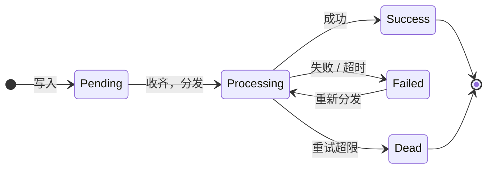
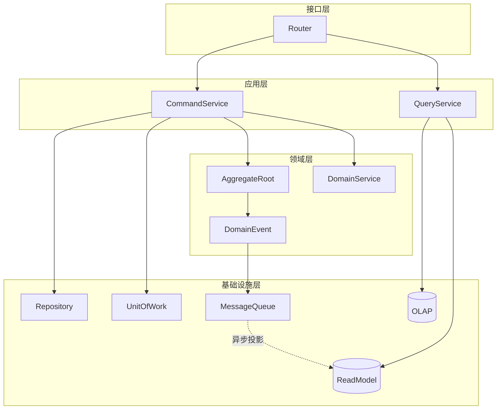

# SumengQAQ

大二在读，自学后端。关注领域驱动设计、分布式事务与形式化验证。

## 方向

| 方向           | 内容                                                               |
| -------------- | ------------------------------------------------------------------ |
| 形式化验证     | 动作的时序逻辑、TLA+、超组合、对称性约简、反例轨迹、分布式事务规约 |
| 领域驱动设计   | 事件风暴、聚合边界、限界上下文、工作单元、实体、值对象、聚合根     |
| 数据密集型应用 | 脏写、写偏斜、隔离级别、幂等、分布式共识                           |

## 消息组状态机

## 分层

## 技术栈

## 项目

