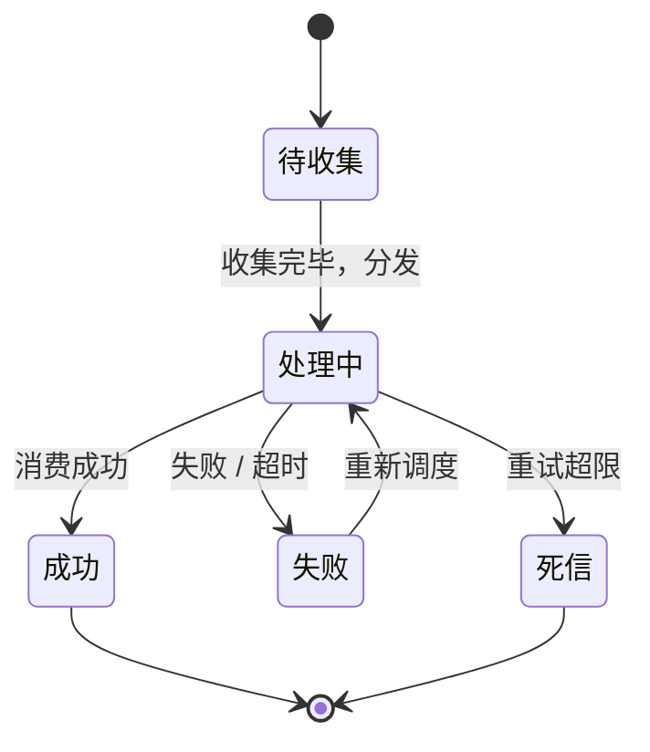

# 你好，我是 SumengQAQ

大二在读，非科班自学后端。方向是 Go / Python 服务端，最近在啃领域驱动设计、分布式事务和 TLA+。

## 在做什么

| 方向         | 内容                                                     |
| ------------ | -------------------------------------------------------- |
| 领域驱动设计 | 聚合边界怎么切、限界上下文怎么分、防腐层什么时候真的需要 |
| 分布式事务   | TCC、Saga、Outbox，三个模式各写了一份 TLA+ 规约          |
| 形式化验证   | 用 TLC 跑模型检查，找并发下的空回滚、悬挂、写偏斜        |

## 一个自己设计的状态机

消息组在中间件里的生命周期，用 TLA+ 验证过：

## 技术栈

## 项目

## 统计

