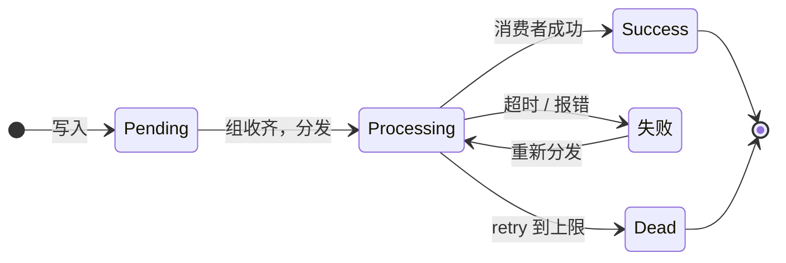

# SumengQAQ

大二，非科班，后端方向。用 TLA+ 验证分布式事务和消息队列的状态机。

> 给消息队列写完规约之后，我把那把锁删掉了。

## 一个消息组的生命周期

消息进来先落文件，攒一批再落库，收齐了才分发给消费者。



## 为什么不用锁

最初担心的是这个：分发协程把 `Processing` 写回表的时候，会覆盖掉消费者刚刚写进去的 `Success`。

后来发现状态机就够了。`Success` 和 `Dead` 是终态，任何想从终态往回改的动作都该被挡住。

```sql
UPDATE domain_events
SET state = 'Processing'
WHERE uid = :uid AND state = 'Processing'
```

影响 0 行，说明已经被改过了，跳过。

> 加锁是把冲突挡在门外，状态机是把冲突变成“什么都没发生”。

## 写规约

```tla
\* 钱不会凭空出现，也不会凭空消失
ResourceConservation ≜
    cost + SumAvailable(v_nodes) + SumFrozen(v_nodes)
        = Cardinality(v_nodes) * 2
```

```tla
\* 组一旦收齐就不会分裂：
\* 快照里的每个 uid，不管事件现在在哪一层，都还凑得齐
FrozenStable ≜
    ∀ k ∈ DOMAIN frozen:
        {x.uid: x ∈ 所有位置的事件, x.group = k[2]} = frozen[k]
```

## 在做什么

| 方向         | 内容                                                  |
| ------------ | ----------------------------------------------------- |
| 形式化验证   | TCC、Saga、Outbox、消息队列，四份 TLA+ 规约，TLC 跑通 |
| 领域驱动设计 | 聚合边界怎么切、限界上下文怎么分、UoW 与事件收集      |
| 消息队列     | 消息组状态机、按组读、先写文件再批量落库              |

## 写领域模型

```python
class Account(AggregateRoot):
    def withdraw(self, amount: Decimal) -> None:
        if self.balance < amount:
            raise InsufficientBalance
        self.balance -= amount
        self.push_event(BalanceWithdrawn(amount))
```

## 技术栈


## 项目

[](https://github.com/SumengQAQ/backend-architecture-notes)

---

<sub>规约和笔记都在 [backend-architecture-notes](https://github.com/SumengQAQ/backend-architecture-notes)，每一篇都有源码和可运行的 TLA+。</sub>
