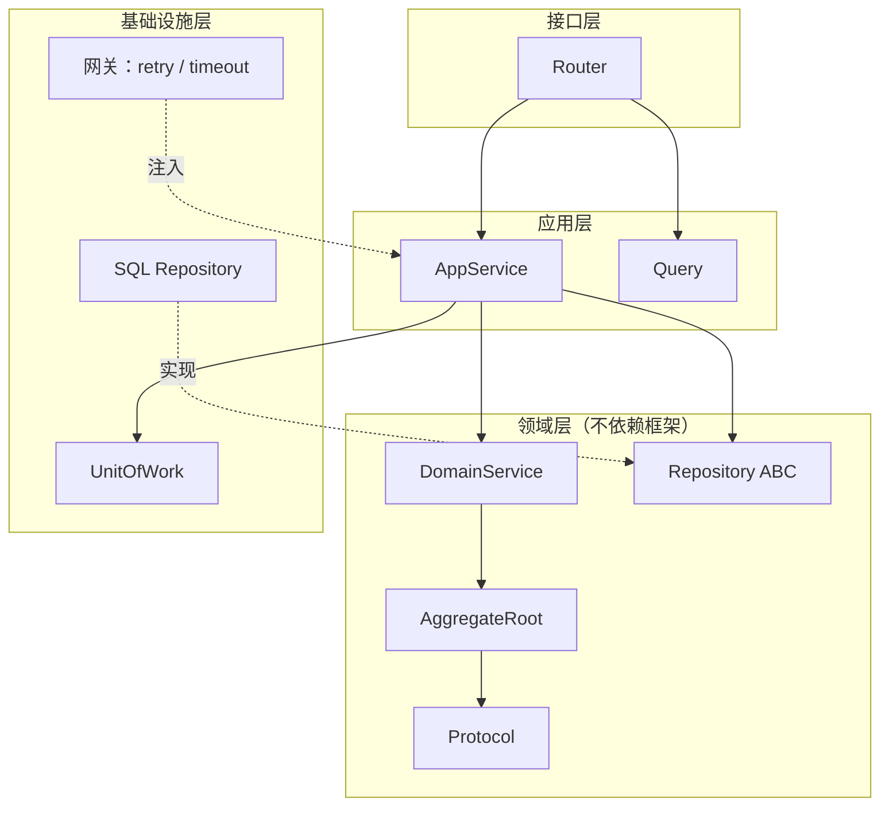

# SumengQAQ

大二在读，自学后端。关注领域驱动设计、分布式事务与形式化验证。

## 方向

| 方向                     | 内容                                                  |
| ------------------------ | ----------------------------------------------------- |
| 形式化验证               | TCC、Saga、Outbox、消息队列，四份 TLA+ 规约，TLC 跑通 |
| 领域驱动设计             | 聚合边界、限界上下文、UoW 与领域事件                  |
| 数据密集型应用中的一致性 | 隔离级别、MVCC、写偏斜、条件更新、重试与幂等          |

## 分层

箭头只有两个方向：上层指向下层，基础设施指向领域层定义的接口。

## 技术栈

## 项目

